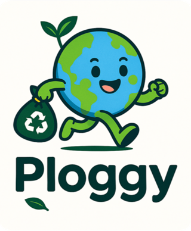
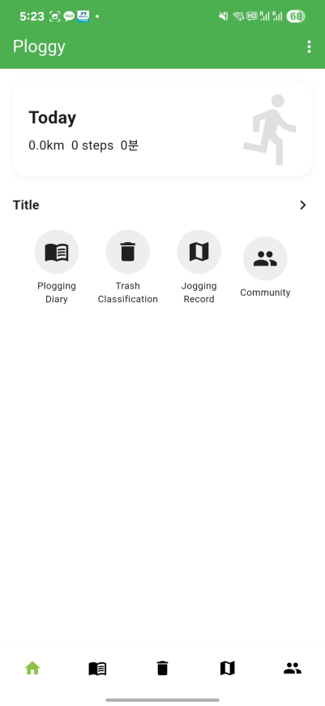
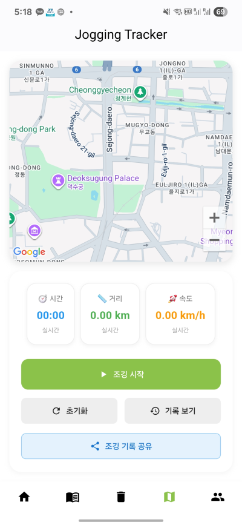
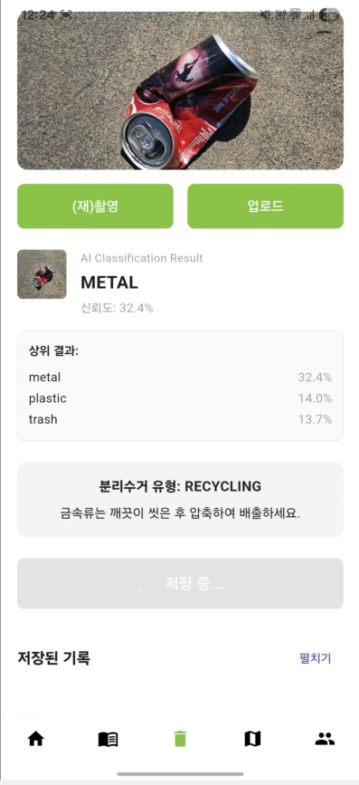
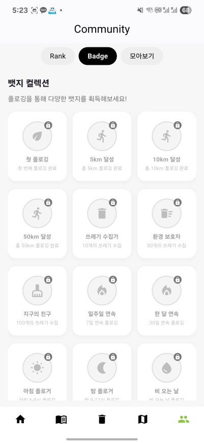
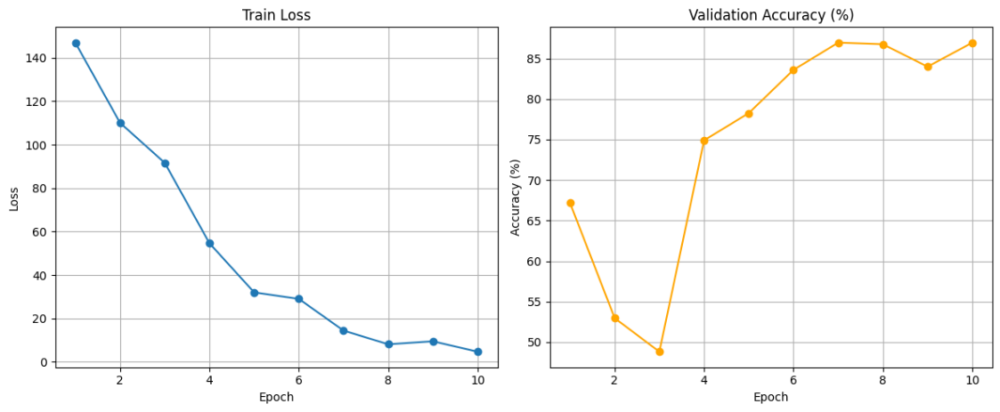
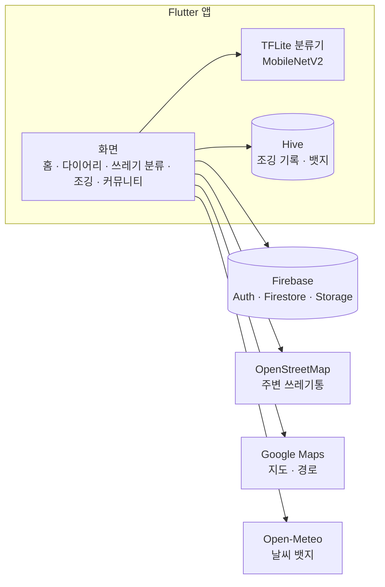

<p align="center">
  
</p>

# Ploggy — AI로 쓰레기를 분류하는 플로깅 앱

> 조깅하면서 쓰레기를 줍는 **플로깅(Plogging)** 을 기록·공유하고, 주운 쓰레기는 **온디바이스 AI**로 분류해 멜버른의 3색 분리수거 통을 안내하는 Flutter 앱

| | |
|---|---|
| **프로그램** | 영남대학교 글로벌 SW 역량 강화 프로그램 1조 캡스톤 (호주 멜버른, RMIT) · 2025.09.22 발표 |
| **팀** | 5명 — AI 이미지 인식 1명, 앱 개발 2명, GPS·조깅 기능 2명 |
| **내 역할** | **AI 쓰레기 분류** (데이터셋 선정·가공, MobileNetV2 학습, TFLite 변환·앱 탑재), 현지 상점 대상 사업성 검증 |
| **기술** | Flutter · Firebase (Auth / Firestore / Storage) · TensorFlow Lite · Google Maps · Hive |

## 왜 만들었나
- 플로깅은 환경 보호와 건강을 함께 챙길 수 있는 활동으로, SNS 언급량이 1년 만에 1,000% 넘게 늘었습니다. (신한카드 2022 트렌드 리포트, 2020→2021)
- 하지만 대부분 일회성 캠페인으로 끝나고, 활동을 기록하고 공유할 전용 서비스가 없습니다.
- 호주에서 조깅은 14세 이상이 정기적으로 하는 활동 3위(약 226만 명, Roy Morgan)이고, 멜버른은 쓰레기통이 일반·재활용·음식물/유기물 3색으로 나뉘어 있어 "주운 쓰레기를 어디에 버리는지" 안내가 필요합니다.

## 주요 기능
| 기능 | 설명 |
|---|---|
| **AI 쓰레기 분류** | 사진을 찍으면 6종(유리·금속·음식물·종이·플라스틱·일반)으로 분류하고, 어느 색 통에 버릴지 안내 |
| **조깅 기록** | 실시간 시간·거리·속도, 지도에 경로 표시, Google 지도 경로 링크로 공유 |
| **주변 쓰레기통** | 현재 위치 1km 안의 쓰레기통·재활용 수거함 표시 (OpenStreetMap) |
| **다이어리·커뮤니티** | 오늘의 조깅과 일기, 누적 거리 랭킹, 뱃지 16종, 게시글 |

## 앱 화면 (2025 캡스톤 당시)
<table>
  <tr>
    <td align="center"><br>홈</td>
    <td align="center"><br>조깅 기록</td>
    <td align="center"><br>AI 쓰레기 분류</td>
    <td align="center"><br>뱃지</td>
  </tr>
</table>

분류 화면의 "신뢰도 32.4%"는 당시 버그 때문에 낮게 표시된 값입니다. 실제 값은 약 90%였고, 2026 개선에서 고쳤습니다. ([원인 분석](docs/ai-model.md#5-캡스톤-이후-찾은-문제-신뢰도가-35를-넘지-못함))

## AI 모델 (내 담당)
| 항목 | 내용 |
|---|---|
| **데이터** | TrashNet → 정확도가 낮아 실제 거리 사진 기반 **TACO**로 전환, 바운딩 박스 기준으로 잘라 분류용 데이터로 가공 |
| **모델** | **MobileNetV2** (224×224) + 분류층 6클래스, 데이터 증강·하이퍼파라미터 튜닝 |
| **결과** | 10 epoch, **검증 정확도 약 87%** (목표 85%) |
| **배포** | TFLite FP16 변환(4.5MB), 서버 없이 **기기 안에서 추론** |
| **분리수거 안내** | 유리·금속·종이·플라스틱 → 재활용(노랑), 음식물 → 유기물(초록), 일반 → 일반(빨강) |



자세히 보기: [AI 모델 문서](docs/ai-model.md)

## 구조


## 2026 개선 (캡스톤 이후)
캡스톤이 끝난 뒤 코드를 다시 점검해서, 버그를 고치고 발표 때 소개했지만 코드에는 미완성이던 기능을 완성했습니다.
원본과 개선본을 커밋으로 나눠 두어서 [비교 화면](https://github.com/SEONGBINJEON/Ploggy/compare/2025-capstone...2026-improved)에서 바뀐 부분을 볼 수 있습니다.

| 문제 | 원인 | 조치 |
|---|---|---|
| AI 신뢰도가 최대 35%로 표시 | 이미 확률인 모델 출력에 Softmax를 한 번 더 적용 | 출력을 그대로 사용, 회귀 테스트 추가 |
| 조깅 중 탭을 옮기면 기록 소실 | 탭을 바꿀 때마다 화면을 폐기하는 구조 | 탭 상태 유지, Android 포그라운드 서비스 |
| 쓰레기통 지도가 안 뜸 | 주사기 수거함 데이터 + API 응답 형식 불일치 | OpenStreetMap으로 교체 |
| 랭킹·경로 공유·뱃지 일부 미구현 | 발표 내용과 코드의 차이 | 기능 구현 |
| 릴리스 빌드 실패 | R8이 TFLite GPU 클래스를 찾지 못함 | ProGuard 규칙 추가 |
| API 키 노출, 전체 공개 DB 규칙 | 키 커밋, 테스트용 규칙 안내 | 키 분리, 보안 규칙 작성 |

**검증**: 정적 분석 이슈 99개 → 0개, 단위 테스트 38개 통과, 디버그·릴리스 APK 빌드 성공 (실기기 테스트는 남아 있음)

자세히 보기: [개선 과정](docs/improvements-2026.md) · [변경 내역](CHANGELOG.md)

## 실행 방법
```bash
flutter pub get
flutter run
```
Firebase 프로젝트 설정 파일은 저장소에 넣지 않았기 때문에, 실행하려면 본인 Firebase 프로젝트를 연결해야 합니다.
Firebase 연결, Google Maps 키, 보안 규칙, APK 빌드 방법은 [설치·실행 문서](docs/setup.md)에 정리했습니다.

## 문서
- [발표자료 (PDF)](docs/presentation.pdf) — 팀원 개인정보와 외부 캠페인 포스터가 담긴 페이지는 뺐습니다.
- [AI 모델](docs/ai-model.md)
- [2026 개선 과정](docs/improvements-2026.md)
- [설치·실행](docs/setup.md)
- [변경 내역](CHANGELOG.md)

## 데이터 출처
- 쓰레기통 위치: © [OpenStreetMap](https://www.openstreetmap.org/copyright) contributors (ODbL), Overpass API
- 날씨: [Open-Meteo](https://open-meteo.com/) (CC BY 4.0)
- 학습 데이터: [TACO](http://tacodataset.org/) (Trash Annotations in Context)
